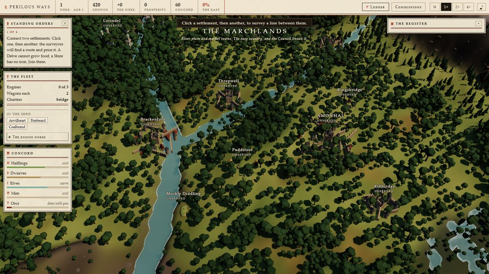
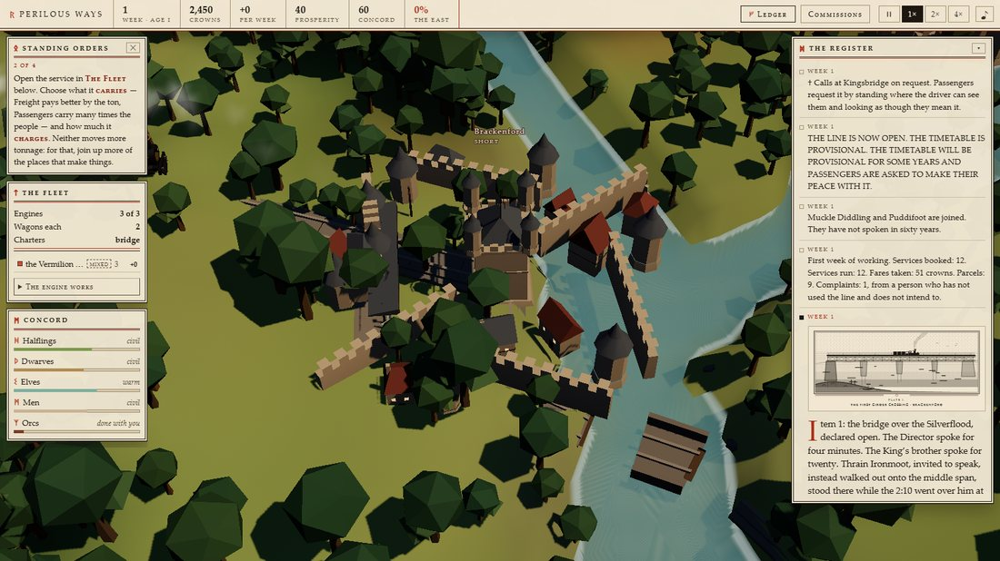
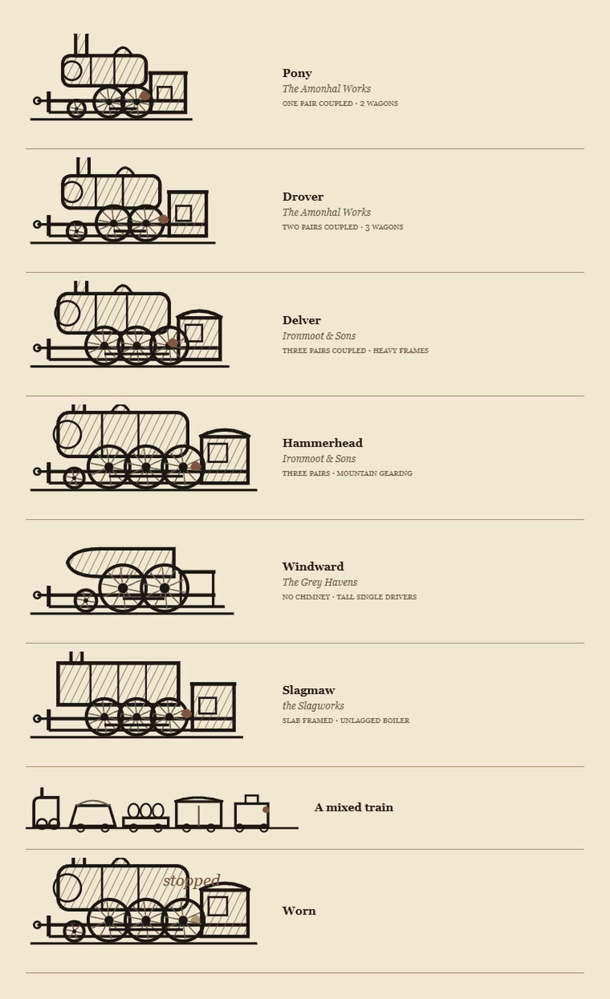

# PERILOUS WAYS

**Live: https://perilous-ways.netlify.app**

A 3D world simulator. You are Director of the Realm Transit Authority on a
continent of halflings, dwarves, elves, men and orcs. You do not fight, rule, or
quest. You lay track, buy engines, and answer correspondence.

Then you find out what a railway is actually for.




---

## Playing

Click a settlement, then another, to survey a line between them. The surveyors
route it themselves across the real heightmap — following contours, bridging
rivers, boring tunnels — and hand you a bill. Authorise it or don't, and say
whether it is a new service or an extension of an existing one.

Then run it. Click a service in *The Fleet* to open its dossier and set:

| Lever | What it does |
|---|---|
| **Carries** | Freight pays better by the ton; Passengers carries several times the people. Neither moves more tonnage — for that, join up more of the places that make things |
| **Fares** | Dear extracts money now and costs prosperity, concord and, eventually, population. Cheap earns less and the realm grows around it |
| **Engines** | Which locomotives work the service — a Hammerhead hauls 56% more than a Pony; a Windward carries 3.4× the passengers and refuses coal |
| **Rolling stock** | Wagons per train, up to what the Authority's stock allows. The consist is drawn, and the wagons show what the line actually carries |
| **Wardens** | 8 crowns a week to halve incidents on that line |
| **Calls at** | Add, drop, reorder, or split the service in two |

### Commissions

The **Commissions** panel (top bar, or `C`) is where the realm asks you for things
by name. Each is a sentence you can act on: *this cargo, to this place, by this
week, for this fee, or else.*

- **Freight** — grain to a delve that cannot feed itself, wine for a wedding that
  cannot move its date, two loads of mithril for the Council, which has not said
  what for. Discharged by ordinary working: run a service that carries the cargo to
  the place named and deliveries count automatically.
- **Passage** — pilgrims to the Grey Quays, excursion traffic to a fair, a Dwarf
  delegation travelling in state. Satisfied by the route *having* passenger service,
  which is what makes a Passenger line worth running.
- **Sieges** — in Age III, a watch is invested and wants arms in four weeks. You can
  decline. If you accept and fail, it is taken, and the Crown remembers.
- **Physic** — a plague wants athelas, which grows in one place on the continent and
  is picked by people who do not hurry.

The **Ledger** (top bar, or `L`) is the answer to "why is this happening": receipts
and upkeep per service, what physically moved yesterday and by what route, which
sections are at capacity, and which settlements are going without *and why* — no
connected source, capacity short at a named place, too many changes.

### The fleet

Every engine is an individual of a **class** — Pony, Drover, Delver, Hammerhead,
Windward, Slagmaw — each an engraved side elevation in the engine works, each a real
tradeoff of haul, speed, passenger appeal, endurance and upkeep, and each sold only
by a people still on speaking terms with the Authority. Engines wear with the work
they do; a worn one hauls less until it is overhauled.



Every engine is an individual with a name, a builder, a shed and a service record.
**Click a train** to open its card: *Anvilheart, Dwarf-built, engine no. 1, working
the Vermilion Way — 4,212 units run, 180 loads, in service since week 3, two
incidents.* From there you can **ride with it** (the camera follows until you take
the wheel back), **sound the whistle**, or jump to the service it works.

Trains whistle on the approach, brake into their calls with a squeal and a shower
of sparks, wait, and pull out chuffing. Idle engines sit in the shed at the foot of
*The Fleet*, and clicking one tells you what it has done.

- **drag** to look, **right-drag** or **shift-drag** to pan, **scroll** to zoom
- **WASD** / arrows to pan, **Q**/**E** to rotate
- **space** to pause, **1**/**2**/**3** for speed, **L** ledger, **C** commissions
- **click a train** to select it, **F** to ride along
- with a service open, clicking a settlement adds it as a further call

## What is actually being simulated

A Delve produces iron and cannot grow food. A Shire grows food and has no tools.
Neither can do anything about it without you. Every other system hangs off that.

- **Trade** — fourteen goods flow over the rail graph each simulated day, limited by
  capacity and travel time, with real manufacturing chains (ore + coal → steel →
  arms).
- **Growth** — prosperity follows met needs, population follows prosperity, and
  settlements visibly build outward through five tiers in their own culture's
  architecture. Unserved places decline and are eventually struck from the register.
- **Concord** — five peoples with opinions. Serve the Elves and they stay; ignore
  them and they take ship from the Grey Quays and do not come back, taking Lore
  out of the economy for good. (Measured: serving them roughly doubles both
  tonnage and income.)
- **Peril** — terrain carries risk. Tunnels, Mirkholt and the Ashenreach produce
  incidents, some of which unmake your track.
- **The Shadow** — fed by what the Authority does: how far east the rails reach,
  what is carried for the orcs, the smoke of the works, how deep the bores go. Held
  back by a realm in concord. Time presses, but it is the smallest term.
- **Money** — a Council grant that pays for settlements *served* and dries up if the
  network stops growing; three lenders who charge in three currencies (the Crown in
  obligation, Ironmoot & Sons in plain interest, the Grey Havens in restraint);
  fares that trade income against goodwill.
- **Age III** — raids on the most exposed sections, a refugee wave moving west along
  your own line, then a host marching on your track at the speed you built it to
  carry. You choose: fortify the road, requisition it for the evacuation, or tear up
  the greatest thing you ever built. Each answer ends the game differently.
- **The Errand** — one item, small, carried by hand, booked to the one place no
  sensible railway goes. It travels as far as your metals reach and waits.

Once a year the Authority files an **annual report** — miles open, places served,
what was struck from the timetable — every figure from your own run, set against
last year's. The numbers are the narrative.

Three ages, several endings, and a Chronicle at the end that is the actual score.

## Running it locally

```
python -m http.server 8577 -d .      # then open http://localhost:8577
```

No build step. Plain ES modules, an import map, and a vendored three.js r185.
`window.PW` is the debug surface (`PW.snapshot()`, `PW.fastForward(weeks)`).

## Tests

Everything here runs without a browser except the last two, which drive the
Chrome already on the machine.

```
node tools/imports.mjs        # every named import resolves to a real export
node tools/smoke.mjs          # real three.js in Node: 37 construction checks
node tools/balance.mjs eardon 30          # an AI plays 30 weeks, reports the loop
node tools/balance.mjs eardon 30 --elfcare  # ...playing well by the Elves
node tools/mapcheck.mjs eardon            # ASCII map + height bands
node tools/routecheck.mjs eardon          # surveyor behaviour and pricing
node tools/visual.mjs eardon              # headless Chrome, screenshots to shots/
node tools/agencycheck.mjs                # drives every operational control, asserts it moved the sim
node tools/traincheck.mjs                 # clicks a train, rides it, whistles, checks it stops and remembers
node tools/commcheck.mjs                  # offers, accepts and discharges commissions; sieges, athelas, mithril
node tools/stockcheck.mjs                 # buys engines, changes rakes, checks the drawings render
node tools/age3check.mjs                  # plays the whole Age III arc once per answer; all must terminate
node tools/freevars.mjs                   # names used but never imported (the class of bug imports.mjs cannot see)
node tools/register.mjs eardon 40         # the register in play order — read it; if you can hear machinery, file a bug
node tools/balance.mjs eardon 40 --story  # the chronicle as one story
node tools/prodcheck.mjs                  # boots the deployed site, plays a few moves
node tools/build.mjs                      # assemble dist/ for deploy
```

## Layout

```
src/world/worldgen.js   authored macro-geography + procedural detail
src/sim/route.js        the surveyor: A* + deck-profile fitting
src/sim/model.js        the economy as tables
src/sim/sim.js          the tick: flow, growth, money, concord, the Shadow
src/sim/events.js       outcomes, petitions, endings — and the writing
src/gfx/terrain.js      ground, sea, 13.5k instanced trees, cloud shadows
src/gfx/props.js        settlement architecture for six cultures, five tiers
src/gfx/trains.js       four engine styles, seven wagon types, steam
src/gfx/rails.js        rails, sleepers, ballast, piers, portals
src/gfx/scene.js        camera, sun, sky, fitted shadows, bloom
src/sim/fleet.js        locomotive classes, names by builder, the roster
src/sim/commissions.js  named clients wanting cargo by a deadline
src/sim/registry.js     draws the written corpus without repeating itself
src/text/reports.js     the corpus: 209 register entries in five peoples' voices
src/gfx/world3d.js      binds sim to scene: stations, consists, growth, labels
src/ui/hud.js           the paperwork: panels, dossiers, ledger, modals
src/ui/plates.js        sixteen engraved SVG plates, tone by hairline
src/ui/locos.js         locomotive side elevations and consist strips
src/audio/audio.js      entirely procedural score and sound
```

`DESIGN.md`, `WORLD.md`, `ART.md`, `VOICE.md`, `UI-SPEC.md` and `INTERFACES.md`
are the specs the code was built against. `VOICE.md` in particular is the record
of how the register's prose was made to stop sounding like a machine, and what it
cost to learn that.
